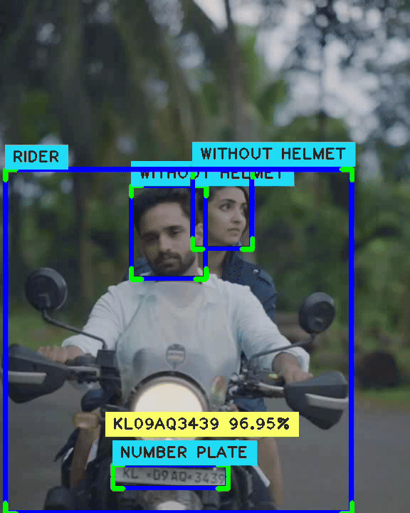
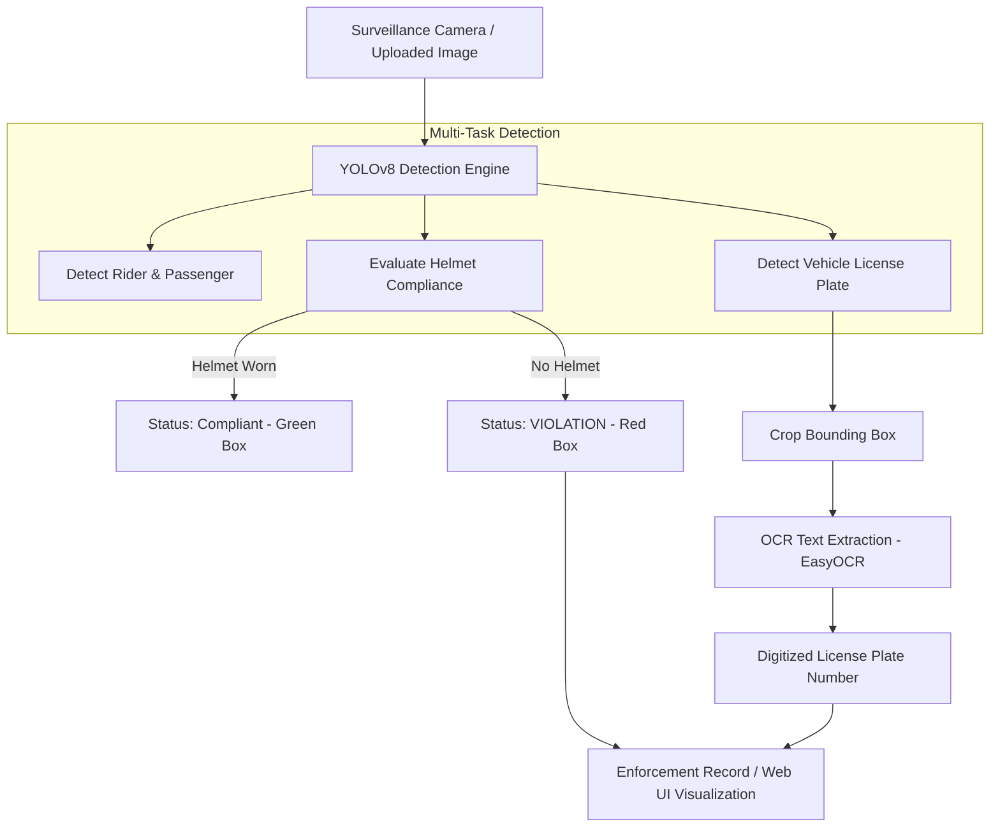

# 🏍️ Real-Time Motorcycle Helmet Violation & Automatic Number Plate Recognition (ANPR)

[](https://www.python.org/)
[](https://github.com/ultralytics/ultralytics)
[](https://palletsprojects.com/p/flask/)
[](https://github.com/JaidedAI/EasyOCR)
[](https://opencv.org/)
[](LICENSE.MD)

An end-to-end intelligent traffic enforcement system combining deep learning object detection (YOLOv8) with Optical Character Recognition (EasyOCR/PaddleOCR). The platform automatically identifies motorcycle riders, classifies helmet compliance, detects license plates, extracts vehicle registration numbers, and provides both a video processing engine and an interactive Flask web interface.

---

## 📸 Demo Preview



*Figure: Automated detection of motorcycle riders, helmet compliance validation, and license plate extraction.*

---

## 🎯 Core Capabilities

- **🏍️ Rider & Helmet Classification**: Accurately differentiates between motorcyclists wearing helmets (`with_helmet`) and those violating traffic laws (`without_helmet`).
- **🪪 Automatic Number Plate Recognition (ANPR)**:
  - Localizes vehicle license plates within the frame.
  - Passes cropped plate regions to an integrated OCR pipeline (EasyOCR / PaddleOCR) to digitize alphanumeric characters.
- **🌐 Interactive Web Dashboard**:
  - Full-featured Flask web application (`helmet_plate_app`).
  - Upload images or frames to inspect bounding boxes, confidence scores, and OCR text readouts.
- **🏋️ Complete Training & Fine-Tuning Pipeline**:
  - Pre-configured dataset configs (`datasets/helmet_dataset.yaml`).
  - Built-in training routines (`training.py`) using YOLOv8 for custom dataset retraining.
- **🎥 Video Stream Processing**:
  - High-throughput inference for pre-recorded surveillance videos and live camera feeds (`main.py`).

---

## 🏗️ System Architecture



---

## 📁 Repository Structure

```
.
├── README.md                      # Project documentation
├── LICENSE.MD                     # MIT License
├── requirements.txt               # Python package dependencies
├── classes.txt                    # Class labels
├── coco128.yaml                   # COCO benchmark configuration
├── bike.gif                       # Visual demonstration
├── output.mp4                     # Sample processed video output
│
├── main.py                        # Primary video detection & OCR pipeline
├── training.py                    # Model training script for YOLOv8
├── image_to_text.py               # OCR helper utility
│
├── datasets/                      # Training & validation datasets
│   ├── helmet_dataset.yaml        # Dataset definition & class mapping
│   ├── train/                     # Training images & annotations
│   └── val/                       # Validation images & annotations
│
├── helmet_plate_app/              # Flask Web Application
│   ├── app.py                     # Flask server entrypoint
│   ├── templates/
│   │   └── index.html             # Web UI frontend
│   ├── static/                    # Styles and static assets
│   └── model/                     # Directory for trained weights (best.pt)
│
├── videos/                        # Test video samples (12.mp4, 22.mp4)
├── runs/                          # Training runs & detection evaluations
└── yolo-weights/                  # Pretrained model weights storage
```

---

## ⚙️ Installation & Setup

### 1. Clone the Repository
```bash
git clone https://github.com/yashraj2408/helmet-violation-license-plate-detection.git
cd helmet-violation-license-plate-detection
```

### 2. Set Up Python Environment
```bash
python3 -m venv .venv

# Activate on macOS / Linux:
source .venv/bin/activate

# Activate on Windows:
.venv\Scripts\activate
```

### 3. Install Dependencies
```bash
pip install --upgrade pip
pip install -r requirements.txt
```

---

## 🚀 Running the Project

### Option 1: Video Inference Pipeline
Run detection directly on video footage with live visualization:
```bash
python main.py
```
> **Note:** Update the model weights path in `main.py` if using custom trained weights (e.g., `runs/detect/train/weights/best.pt` or `yolov8n.pt`).

### Option 2: Flask Web Application
Launch the interactive web UI to test single images or frames:
```bash
cd helmet_plate_app
python app.py
```
Then navigate to [http://localhost:5000](http://localhost:5000) in your web browser.

### Option 3: Train / Fine-tune Custom Model
To train YOLOv8 on the bundled dataset:
```bash
python training.py
```
Trained model checkpoints will be stored automatically in `runs/detect/`.

---

## 📊 Dataset Information

- Includes annotated images covering diverse angles, lighting conditions, and road environments.
- Dataset classes:
  - `rider`
  - `with_helmet`
  - `without_helmet`
  - `number_plate`
- Reference dataset: [Kaggle Helmet & Number Plate Dataset](https://www.kaggle.com/datasets/aneesarom/rider-with-helmet-without-helmet-number-plate/data).

---

## 📄 License

This project is licensed under the [MIT License](LICENSE.MD).
